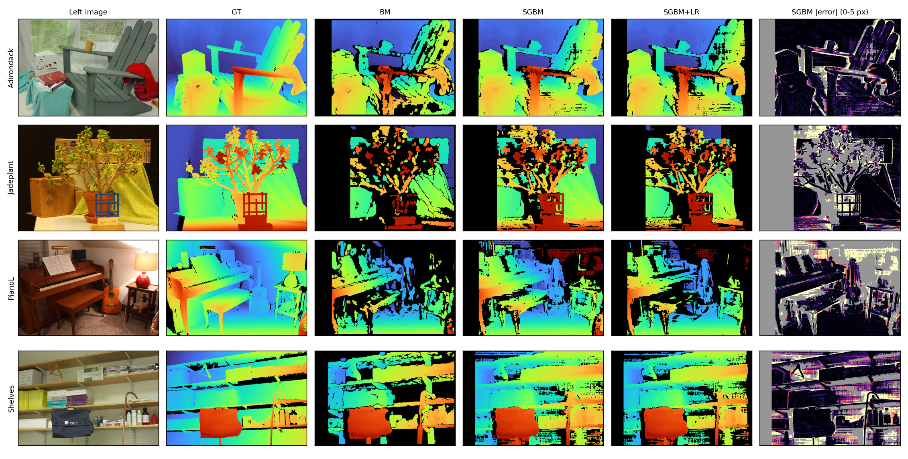
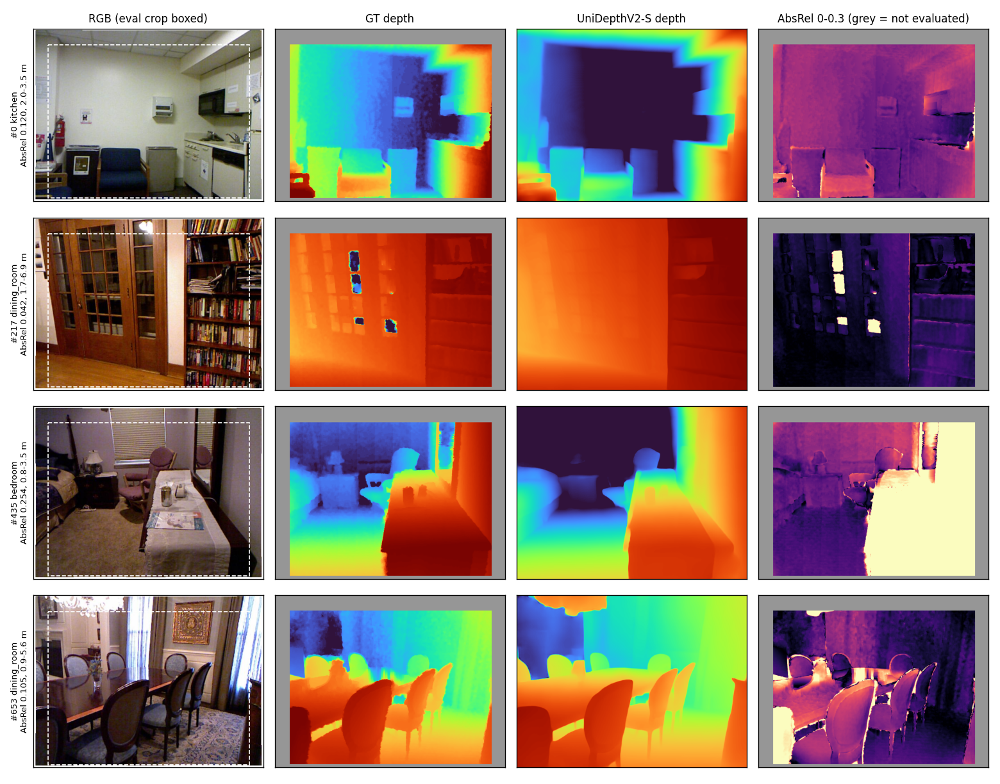
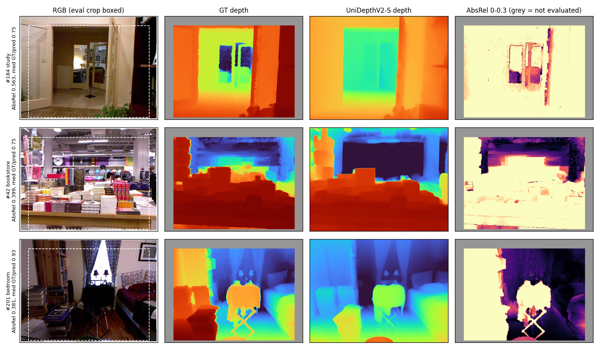
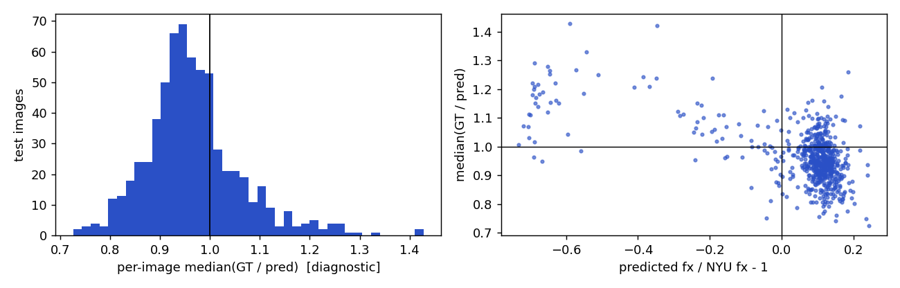
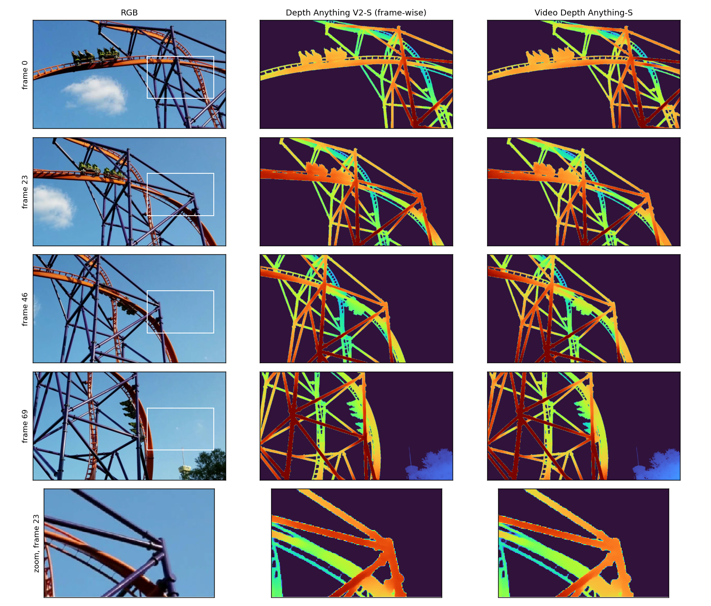
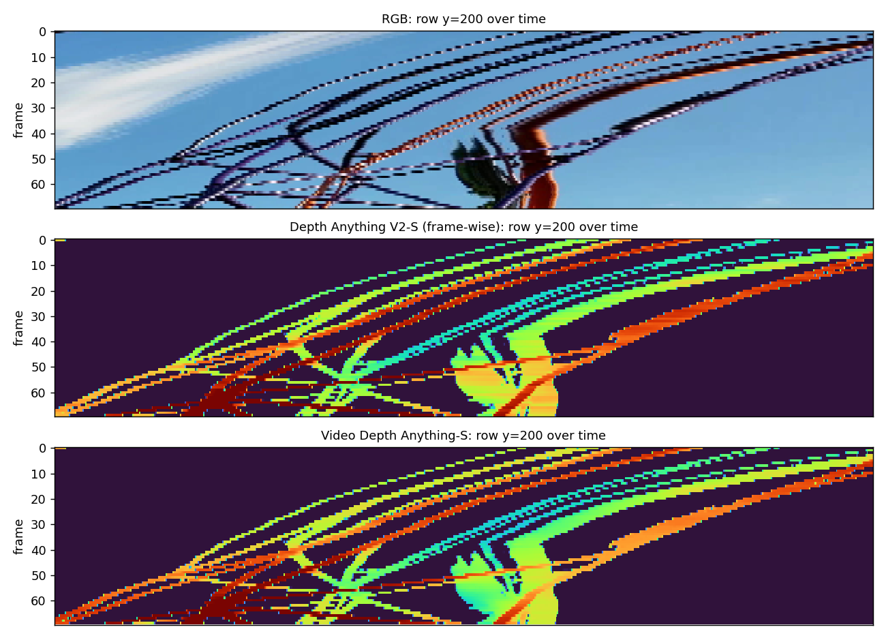
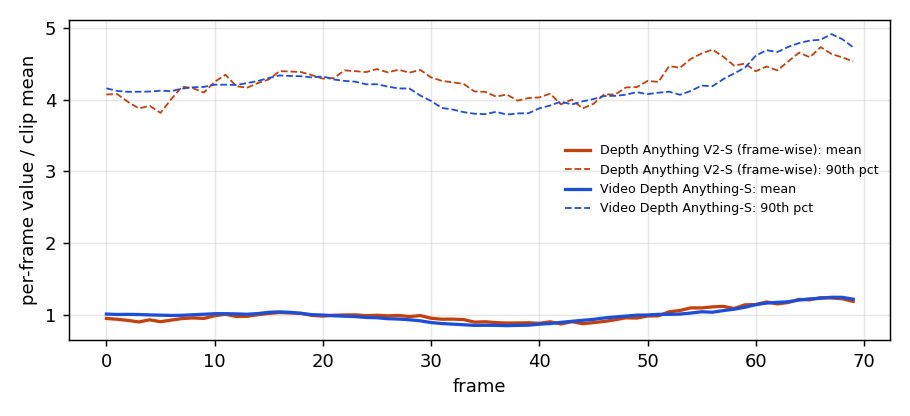
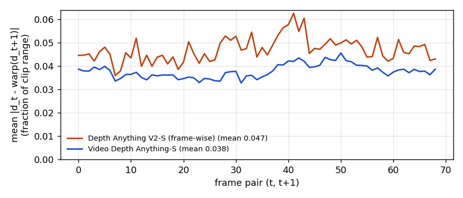

# Monocular Metric Depth Estimation & Video Consistency

AIAA 3201 (Introduction to Computer Vision), Project 3. Classical stereo on Middlebury, zero-shot metric depth (UniDepthV2-S) on NYU Depth V2, and frame-wise vs video depth (Depth Anything V2-S vs Video Depth Anything-S) on the DAVIS rollercoaster clip.

Research plan (Chinese): [RESEARCH_PLAN.md](RESEARCH_PLAN.md)

| Part | Status |
|---|---|
| 1.1 Classical stereo (Middlebury trainingQ) | done |
| 1.2 / 2.2 Frame-wise vs video depth (DAVIS clip) | done |
| 2.1 Metric depth on NYU (UniDepthV2-S) | done |
| 3 Improvement + application demo | not started |

## Setup

Tested on Windows 11, NVIDIA RTX 5070 Ti 16 GB, Python 3.11, PyTorch 2.10 (CUDA 12.8).

```bash
git clone --recurse-submodules https://github.com/NanFeiDeXuMu/cvProject.git
cd cvProject
conda create -n depth python=3.11 -y && conda activate depth
pip install torch torchvision --index-url https://download.pytorch.org/whl/cu128   # Blackwell GPUs need CUDA 12.8+
pip install -r requirements.txt
```

The three official repositories are git submodules under `third_party/` and are imported directly; none of them is modified. Their pinned `torch==2.1.1` / `xformers` requirements are not installed, because those builds do not run on sm_120 GPUs; all three fall back to standard attention without xformers.

## Data and weights

```bash
bash scripts/download_data.sh           # Middlebury Q (~43 MB), DA-V2-S + VDA-S weights, NYU labeled .mat (2.8 GB) + splits
python -I src/nyu/extract_nyu.py        # NYU .mat -> data/nyu/{test,train}_{rgb,depth}.npy + scene metadata
```

The NYU file is fetched with 16 parallel range requests (`scripts/parallel_fetch.sh`), since the server limits per-connection speed. UniDepthV2-S (`lpiccinelli/unidepth-v2-vits14`) is downloaded from Hugging Face on first use. The video clip ships with the Video Depth Anything submodule.

Layout after download: `data/middlebury/MiddEval3/trainingQ/<scene>/`, `data/raw/nyu/`, `data/nyu/`, `checkpoints/`.

## Reproduce

All scripts run from the repository root. `-I` keeps Python from importing anything from the working directory; each script adds the repo root itself.

```bash
python -I src/stereo/run_stereo.py              # Part 1.1 -> results/stereo_*.csv, figures/stereo_overview.png, per-scene panels in outputs/stereo/figures/
python -I src/video/run_video_depth.py          # Part 1.2 + 2.2 inference -> outputs/video/*.npz, results/video_efficiency.csv
python -I src/video/temporal_consistency.py     # optional RAFT-warped temporal error -> results/video_temporal_*.csv
python -I src/video/make_video_figures.py       # side-by-side mp4 + figures/video_*.png
python -I src/nyu/run_unidepth.py               # Part 2.1 inference on the 654 test images
python -I src/nyu/eval_nyu.py                   # course metrics -> results/nyu_unidepthv2_s_*.csv, figures/nyu_*.png
python -I src/nyu/run_unidepth.py --gt_intrinsics && python -I src/nyu/eval_nyu.py --name unidepthv2_s_gtK --no-figures   # diagnostic only
```

On Windows, scripts that import PyTorch do no plotting: matplotlib's text layout aborts with a duplicate `libiomp5md.dll` once PyTorch's OpenMP runtime is loaded. Plots are drawn in separate scripts from saved results.

## Results

### Part 1.1: Classical stereo (Middlebury v3, 15 trainingQ pairs)

OpenCV StereoBM (block 15) and StereoSGBM (block 5, 3-way, P1 = 8·3·25, P2 = 32·3·25), `numDisparities` = calib `ndisp` rounded up to a multiple of 16. Disparity = OpenCV output / 16. Depth: `Z = f · baseline / (d + doffs) / 1000` m.

**Invalid-prediction rule:** a pixel is invalid if `d <= 0` after dividing by 16 (OpenCV writes `minDisparity - 1` for unmatched and speckle-filtered pixels). `SGBM+LR` also drops pixels where `|d_L(x) - d_R(x - d_L(x))| > 1 px`. Errors are computed on pixels with finite, positive GT where the prediction is valid; "valid" is that count divided by the number of GT-valid pixels.

| Method | MAE (px) | MAE non-occluded (px) | Valid predictions | bad-2.0 | Depth AbsRel | Time / pair (ms, CPU) |
|---|---:|---:|---:|---:|---:|---:|
| StereoBM | 1.560 | 1.128 | 58.5% | 10.0% | 0.019 | 8.6 |
| StereoSGBM | 1.873 | 1.389 | 75.9% | 12.2% | 0.021 | 19.1 |
| StereoSGBM + LR check | 1.376 | 1.040 | 64.0% | 9.2% | 0.016 | 50.2 |

Mean over the 15 scenes; per-scene numbers in `results/stereo_per_scene.csv`. Lower MAE for BM comes with far fewer valid pixels: it only answers on well-textured regions. The hardest scenes are Jadeplant (thin branches, large occlusions) and PianoL (illumination change between views).



### Part 2.1: Zero-shot metric depth on NYU Depth V2 (654 test images)

Course protocol: predictions at 480×640, Eigen crop `[45:471, 41:601]`, GT in [0.001, 10] m, predictions clipped to that range, per-image metrics averaged over all 654 test images, no scale alignment. The model gets RGB only and runs with repository defaults.

| Method | AbsRel ↓ | RMSE (m) ↓ | δ1 ↑ | Network input | Precision | ms / image | Peak GPU memory |
|---|---:|---:|---:|---|---|---:|---:|
| **UniDepthV2-S, zero-shot, RGB only** | **0.1145** | **0.399** | **0.892** | 644×490 | FP16 autocast (repo default) | 37.9 | 498 MiB |
| *Diagnostic only:* same model given NYU's calibrated intrinsics | 0.0922 | 0.358 | 0.926 | 644×490 | FP16 autocast | 40.8 | 498 MiB |

The diagnostic row uses camera information the protocol does not give the model, so it is not a reproduction result. It shows how much of the error comes from estimating the camera.

- **Distribution.** The median image has AbsRel 0.101 and δ1 0.955; 71 images with AbsRel > 0.2 pull the mean down. Per-image and per-scene-type numbers are in `results/nyu_unidepthv2_s_*.csv`.
- **Absolute scale.** Per-image median(GT / pred) is 0.955 (IQR 0.908–1.006): predictions are typically 4–5% too far. Predicted focal length has a median of 574 px against NYU's 518.9 px (+10.6%), and a separate cluster of images with focal estimates 60–70% too short comes out too near. Focal error and scale error correlate at −0.58. With the calibrated camera that correlation drops to −0.05 and AbsRel falls to 0.092.
- **Precision is not a factor.** FP16 and FP32 give identical AbsRel on the first 100 test images.
- **Failure cases** (`figures/nyu_worst3.png`): glass doors and mirrors, large open spaces (bookstore), and dark objects where the Kinect ground truth is itself in-painted.





### Part 1.2 / 2.2: Frame-wise vs video depth (davis_rollercoaster.mp4)

The provided clip has **70 frames** (960×540, 24 fps), so "the first 100 frames" is the whole clip; `--max_len 100` has no effect. Both models receive the same 70 frames, read by Video Depth Anything's reader with `--max_res 640` (640×360), and both use `input_size 518` (network input 924×518). Outputs are relative depth.

Each method gets one normalization, the 2nd-98th percentile of its own predictions over all frames, frozen for every frame (`outputs/video/normalization.json`). Both use the same palette (turbo, near = warm). Colors do not represent a shared metric scale.

| Method | Precision | ms / frame | Peak GPU memory |
|---|---|---:|---:|
| Depth Anything V2-Small, frame-wise | FP32 (repo default) | 54.7 | 415 MiB |
| Video Depth Anything-Small, offline | FP16 autocast (repo default) | 90.4 | 8015 MiB |

Times include pre/post-processing; VDA's time is one call over the whole clip divided by 70. VDA processes 32-frame windows with 10-frame overlap, which accounts for most of its memory.

Side-by-side video (RGB | frame-wise | video): `outputs/video/davis_rollercoaster_side_by_side.mp4`.



The x-t slice stacks image row y = 200 over time. Flicker shows up as horizontal streaks across a beam's track; the frame-wise model has visibly more of them, especially on the coaster car (frames 45-65).



Per-frame mean and 90th percentile of each model's raw output, divided by its clip mean. Both follow the same slow trend as the camera pans, but the frame-wise 90th percentile jitters from frame to frame while the video model's curve is smooth.



**Optional numeric check.** RAFT-large flow between consecutive frames, a forward-backward test to drop occluded pixels, then `|d_t - warp(d_{t+1})|` with each method's depth mapped to [0, 1] by its frozen clip range. Both methods are scored on identical pixels; sky is excluded using the frame-wise model, which outputs exactly 0 there.

| Method | Mean warp error (fraction of clip range) | Max over 69 pairs |
|---|---:|---:|
| Depth Anything V2-S, frame-wise | 0.047 | 0.063 |
| Video Depth Anything-S | 0.038 | 0.046 |

VDA is about 20% lower, consistently across the clip. Both share an error floor from flow mistakes at the edges of thin beams.

**Remaining artifact.** VDA stitches its 32-frame windows with a scale + shift alignment that is only clipped below zero. The sky is exactly 0 in the first window (frames 0–23) and drifts up to 0.4% of VDA's range by frame 69 (`results/video_sky_level.csv`). That is too small to see in the colorized video, but it means VDA no longer outputs exactly 0 at infinity after its first window. Any metric that masks sky by thresholding VDA's own output will silently include sky pixels from frame 24 on.



## Acknowledgements

Datasets: Middlebury Stereo 2014 (Scharstein et al., GCPR 2014), NYU Depth V2 (Silberman et al., ECCV 2012), DAVIS clip from the Video Depth Anything repository. Models and code: [Depth Anything V2](https://github.com/DepthAnything/Depth-Anything-V2), [Video Depth Anything](https://github.com/DepthAnything/Video-Depth-Anything), [UniDepth](https://github.com/lpiccinelli-eth/UniDepth). Each is used under its own license.
